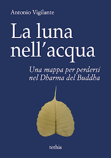

Il Buddha diceva di non essere un maestro "dal pugno chiuso", di quelli che trasmettono insegnamenti segreti, esoterici, il cui senso più profondo è riservato a pochi. Il suo messaggio vuole essere chiaro, lineare, accessibile a tutti e da tutti verificabile. Questo libro intende presentarlo ispirandosi a questa stessa chiarezza, mostrando i diversi passaggi logici e filosofici del Dharma del Buddha in modo colloquiale, quasi intimo. Più che come una religione, ossia un insieme di pratiche, di rituali, di concezioni codificate, il buddhismo è avvicinato come l'esito di una ricerca filosofica al tempo stesso profonda ed umanissima (poiché parte da ciò che c'è di più umano: la sofferenza), e tuttavia fallibile, aperta a nuovi contributi, a sviluppi inediti, anche in seguito all'incontro con l\`occidente e la sua tradizione di pensiero.

Il libro, pubblicato da Tethis (Torino), è rilasciato con la seguente licenza:

È concessa la libera distribuzione della presente opera, purché a titolo gratuito e senza alcuna modifica nell'attribuzione, nel contenuto e nella forma. Sono riservati all'autore tutti gli altri diritti; è in particolare espressamente vietata qualsiasi nuova edizione non autorizzata dall'autore.

È possibile acquistare il libro in versione ebook al costo di 3,99 euro nei seguenti store: [Amazon Kindle](https://www.amazon.it/luna-nellacqua-perdersi-Dharma-Buddha-ebook/dp/B07VQL144F/ref=sr_1_1?__mk_it_IT=%C3%85M%C3%85%C5%BD%C3%95%C3%91&keywords=vigilante+la+luna+nell%27acqua&qid=1564485070&s=gateway&sr=8-1) [IBS](https://www.ibs.it/luna-nell-acqua-ebook-antonio-vigilante/e/9788834160022?lgw_code=1122-E9788834160022&gclid=CjwKCAjw1f_pBRAEEiwApp0JKNE2PlK1ALLC1tNX-LcEqiLEn_MUnvYozg0MR7Yrv4YFrs7cQGy1dRoCQY0QAvD_BwE) [Kobo](https://www.kobo.com/us/en/ebook/la-luna-nell-acqua) [Mondadori](https://www.mondadoristore.it/La-luna-nell-acqua-Antonio-Vigilante/eai978883416002/)

Oppure in cartaceo al costo 13,99 euro nei seguenti store: [Amazon](https://www.amazon.it/luna-nellacqua-perdersi-Dharma-Buddha/dp/8834160835/ref=sr_1_1?__mk_it_IT=%C3%85M%C3%85%C5%BD%C3%95%C3%91&keywords=La+luna+nell%27acqua&qid=1567923584&s=gateway&sr=8-1) [Feltrinelli](https://www.lafeltrinelli.it/libri/antonio-vigilante/luna-nell-acqua-una-mappa/9788834160831) [IBS](https://www.ibs.it/luna-nell-acqua-mappa-per-libro-antonio-vigilante/e/9788834160831) [Mondadori](https://www.mondadoristore.it/luna-nell-acqua-mappa-Antonio-Vigilante/eai978883416083/)

Il libro può essere anche scaricato gratuitamente in formato elettronico (epub, mobi o pdf) [a questo link](https://archive.org/details/vigilante_luna).

Se hai letto il libro, ti sarò grato se vorrai comunicarmi il tuo parere scrivendo nei commenti di questa pagina o mandandomi una mail all’indirizzo rimarerum at gmail.com
