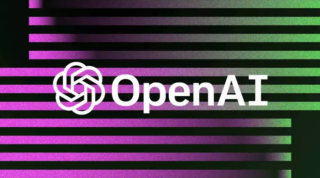

**Ultimi**: [Gianni Vattimo e gli avvoltoi](https://www.attraversamenti.info/gianni-vattimo-e-gli-avvoltoi/) / [Come amore confonde i sentieri](https://www.attraversamenti.info/come-amore-confonde-i-sentieri/)/ [Gli oscuri intenti di Bernardo Zannoni](https://www.attraversamenti.info/gli-oscuri-intenti-di-bernardo-zannoni/)

### I fantasmi di Alfredo Cospito

La “via immaginifica alla distruzione dell’esistente” di Alfredo Cospito e della Federazione Anarchica Informale è pura, masturbatoria esaltazione della violenza. [Leggi l'articolo](https://www.attraversamenti.info/i-fantasmi-di-alfredo-cospito/)

### Il dovere di essere transculturali

\[caption id="attachment\_4927" align="alignleft" width="352"\] https://unsplash.com/it/@cdd20\[/caption\]

I grandi capolavori del pensiero (e della poesia, della letteratura, dell’arte) appartengono all’umanità ed hanno uno straordinario valore formativo. Per questo abbiamo il dovere di farli conoscere agli studenti. [Leggi l'articolo](https://www.attraversamenti.info/il-dovere-di-essere-transculturali/)

### ChatGPT e la pulizia del water

I docenti italiani fanno _metà lavoro_, lasciando alla famiglia o a docenti privati il compito di _seguire gli studenti a casa_. Il risultato è la nota disuguaglianza della scuola italiana. Che chatGPT può contribuire a combattere. [Leggi l'articolo](https://www.attraversamenti.info/chatgpt-e-la-pulizia-del-water/)

### Un altro mondo (virtuale) è possibile

I social network ci abituano ad un mondo in cui tutto è proprietà privata e l’intera nostra vita serve ad estrarre profitto. Ma forse esiste un’alternativa. [Leggi l’articolo](https://www.attraversamenti.info/un-altro-mondo-virtuale-e-possibile/)

### La scuola italiana nello specchio di quella americana

La scuola statunitense ha imboccato la strada della standardizzazione e dei test, con esiti disastrosi. E quella italiana? [Leggi l’articolo](https://www.attraversamenti.info/la-scuola-italiana-nello-specchio-di-quella-americana/)

### L’angelo non necessario. Il fascismo di Putin

Il sistema di potere di Putin è una nuova forma di fascismo, i cui ideologi sono il patriarca Kirill e Alexandr Dugin. [Leggi l’articolo](https://www.attraversamenti.info/langelo-non-necessario-il-fascismo-di-putin/)

### La guerra in Ucraina e la crisi della nonviolenza

La guerra in Ucraina ha mostrato i limiti e il carattere ideologico della nonviolenza. I miei articoli: [Non c’è pace senza giustizia. Lettera aperta al Movimento Nonviolento](https://www.attraversamenti.info/non-ce-pace-senza-giustizia-lettera-aperta-al-movimento-nonviolento/) / [La prassi che manca](https://www.attraversamenti.info/la-prassi-che-manca/) / [Quale alternativa nonviolenta?](https://www.attraversamenti.info/quale-alternativa-nonviolenta/) / [Cosa non è la nonviolenza](https://www.attraversamenti.info/cosa-non-e-la-nonviolenza/) / [Predicare la nonviolenza a chi sta sotto le bombe](https://www.attraversamenti.info/predicare-la-nonviolenza-a-chi-sta-sotto-le-bombe/)

* * *

### Archivio

[Leggi tutti gli articoli](https://www.attraversamenti.info/blog/) in ordine cronologico.
